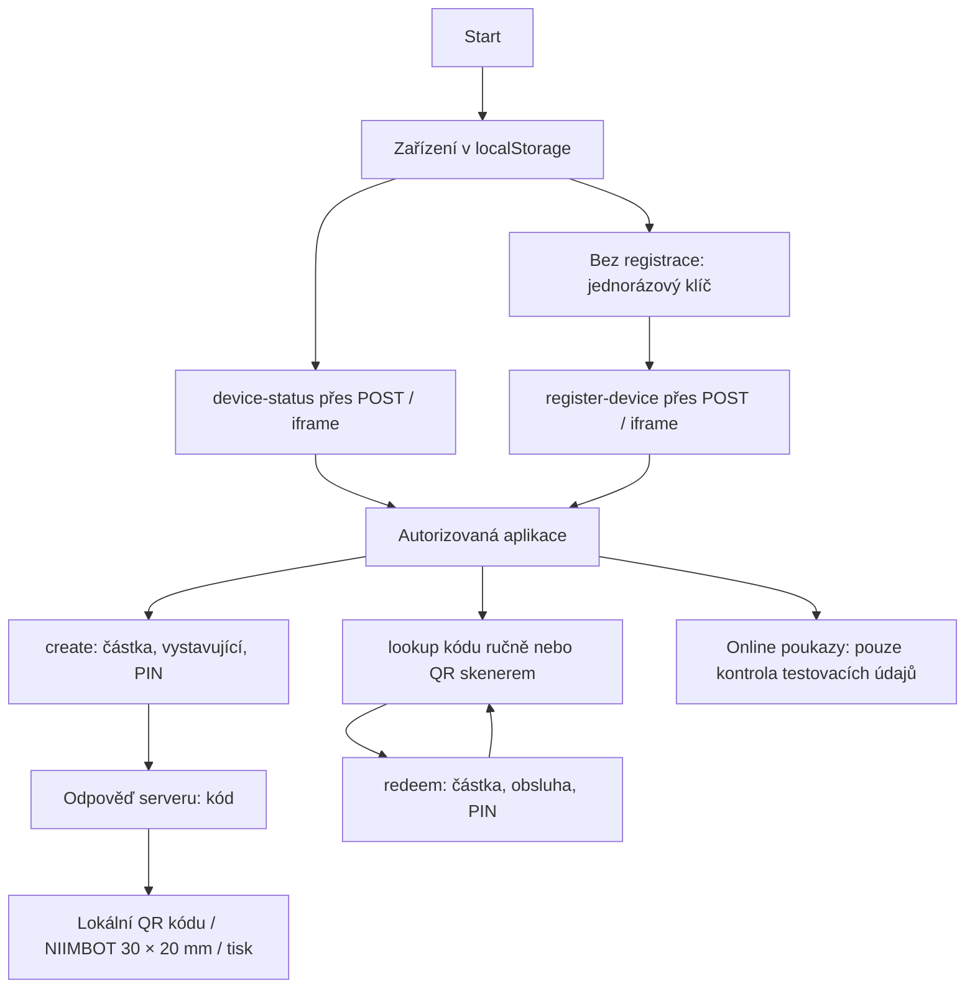

# Etapa 1 — nepropojený návrh

## Rozsah a současný tok

Změny: `index.html` přidává formulář uvnitř autorizované části a tři oznámení
stavu autorizace izolovanému modulu `online-vouchers.js`. Modul provádí pouze
lokální kontrolu formátu. Nemá API, úložiště, emisi kódů, QR, PDF ani odesílání.
PIN se neověřuje a po úspěšné kontrole se smaže. Ztráta autorizace vymaže formulář.
E-mail ani ostatní údaje se nevypisují do zpráv. Používat jen smyšlené údaje.

`postToAppsScript` přidává údaje zařízení a používá skrytý formulář/iframe a
odpovědi postMessage. Stávající autorizace, create, lookup, redeem, kamera,
QR i tisk zůstávají implementačně stejné. Apps Script a jeho schéma neznáme;
diagram popisuje pouze viditelný klient. Skrytí UI není serverové oprávnění.

## Návrh backendu — zatím neimplementováno

Akce je nutné přizpůsobit dodanému testovacímu backendu. Každá musí znovu
ověřit zařízení serverově, u mutací PIN a oprávnění pracovníka/prodejny.
Nikdy nepřebírat autoritu z checkboxu, klientské částky či veřejného webhooku.

| Navržená akce | Význam |
| --- | --- |
| online-preview | Autorizované načtení objednávky serverovým Wix konektorem; ověření produktu, měny CZK, položek a částky. Žádná emise. |
| online-issue | Ruční potvrzení celé bankovní platby oprávněným pracovníkem; atomické vydání přes existující serverovou logiku. |
| online-get-pdf | Autorizované získání nebo regenerace soukromého PDF stejného vydaného kódu. |
| online-mark-sent | Autorizovaný audit ručního odeslání již připraveného PDF. |

Nedestruktivní nový list `OnlineObjednavky`: `wixOrderId`, `wixLineItemId`,
`unitIndex`, složený jednoznačný klíč (bez nejednoznačného spojování řetězců),
`amountMinor` (haléře, celé číslo), `currency`, `status`, `voucherId`,
`voucherCode`, soukromý `driveId`, `customerEmail`, `issuerId`, `storeId`,
`createdAt`, `paymentConfirmedAt`, `issuedAt`, `pdfReadyAt`, `sentAt`,
`cancelledAt`, `updatedAt`, `lastErrorCode`. Pole a mapování stávající tabulky
voucherů ověřit až podle zdrojů; nevytvářet paralelní registr platných kódů.
Samostatný přístupově chráněný audit zaznamená aktéra, čas, přechod, důvod a
request ID; bez PIN, tokenů a zákaznického e-mailu v diagnostických logách.

Stavy: `PENDING_PAYMENT → PAYMENT_CONFIRMED → ISSUED → PDF_READY → SENT`.
`CANCELLED` před emisí; refundaci či storno po emisi řešit ručně dle dohodnuté
politiky, samotný stav nesmí předstírat zneplatnění voucheru. Částečná platba,
nesoulad částky/měny a neznámý produkt vydání blokují.

`LockService.getScriptLock()` obepne načtení klíče, kontrolu stavu a emisi.
Použít stejný zámek i na ostatních relevantních cestách. Samotný LockService
není transakce napříč listy: po pádu mezi zápisy nesmí retry slepě vydat nový
kód. Existující serverová funkce musí podporovat dohledatelný idempotentní
klíč ve stejném registru; jinak zablokovat retry a vyžadovat ruční smíření.
Nejprve trvale uložit vazbu vydaného voucheru, teprve potom generovat PDF.
Timeout má neurčitý výsledek; znovu načíst stav podle téhož klíče. Dvojklik,
souběh a restart nesmějí vytvořit další platný voucher. Chyba PDF zachová
`ISSUED` a kód; regenerace pracuje výhradně s ním.

Wix secrets patří pouze na server. Před napojením ověřit Gift Cards versus
Stores produkt a automatické odesílání druhého kódu. Budoucí payment event
slouží jen jako trigger pro serverové načtení a kontrolu `PAID`, položek,
částky, měny a idempotence; nyní jej nezapínat. Wix checkout uplatnění není
součástí této etapy ani implementováno.

## Blokery, rizika a rollback

Chybí testovací Apps Script včetně autorizační/emisní logiky, schéma registru,
oddělená testovací tabulka a deployment se samostatnou konfigurací, PDF grafika,
pravidla platnosti a ověření typu produktu ve Wixu. Předání bez osobních dat
a tajných hodnot; tajemství nastavovat mimo repo. Bez těchto vstupů nelze
ověřit serverovou bezpečnost, PDF ani přijímací scénář. Žádný backend nebyl
kontaktován, nic nebylo nasazeno. Existující stránka při běžném spuštění
nadále používá své dosavadní API: testovat výhradně s blokováním sítě nebo
s dodaným odděleným backendem.

Rollback: odstranit nový section, tři volání `onlineVoucherMock` a script tag
z `index.html`, odstranit nový JS a dokumenty/testy; nejsou žádné změny dat,
backendu ani vzdálené konfigurace. Po commitu použít revert příslušného commitu.
